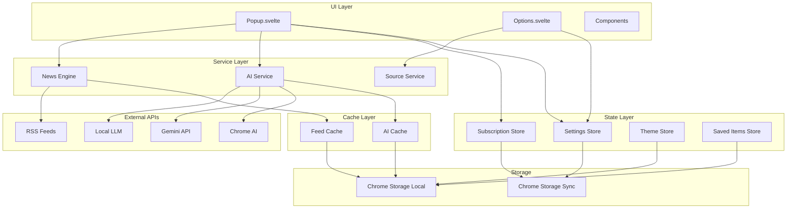
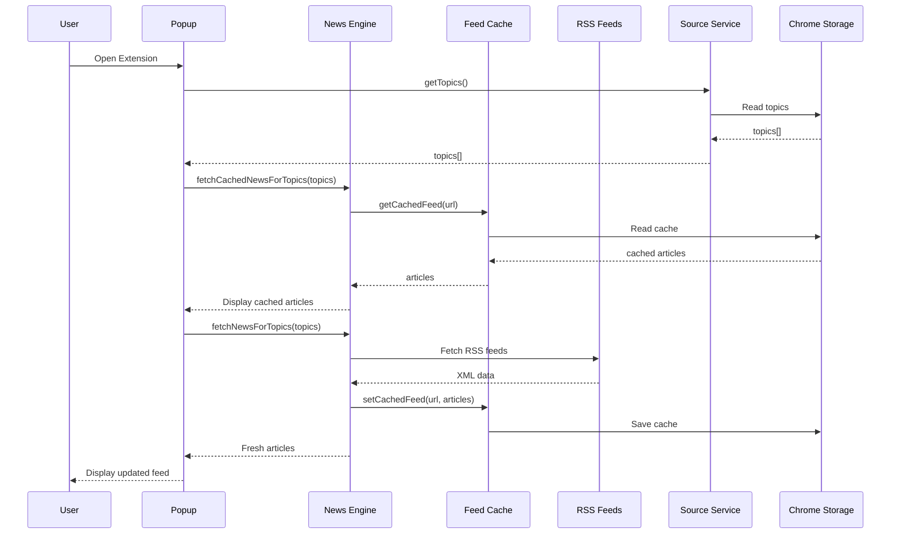
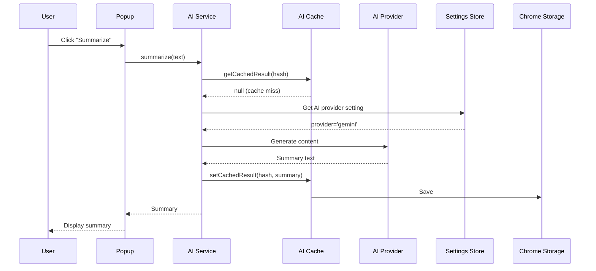
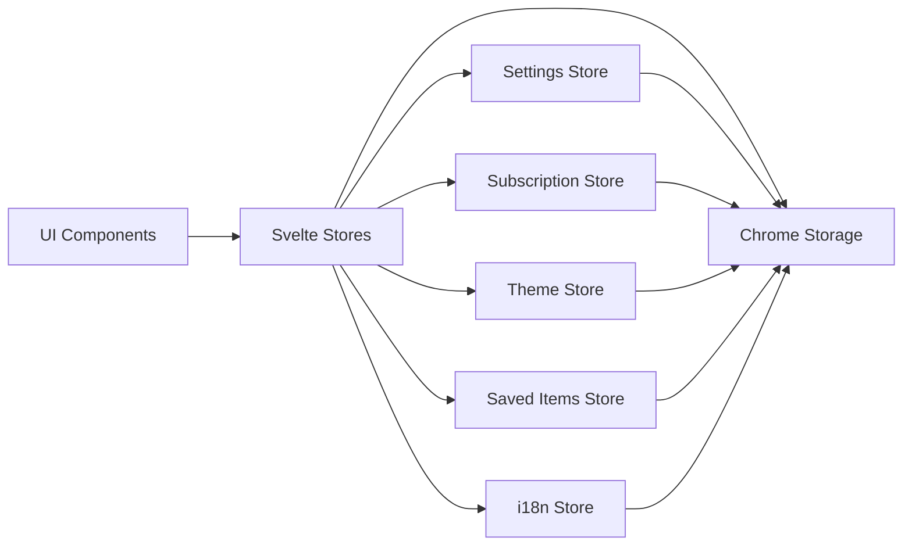
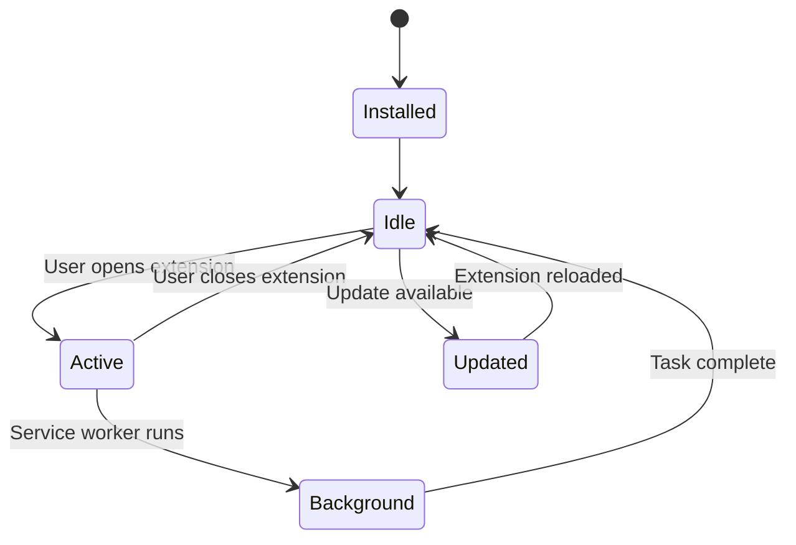

# System Architecture

This document provides a high-level overview of NewsLens AI's architecture, component interactions, and data flow.

## Table of Contents

- [Architecture Overview](#architecture-overview)
- [Component Diagram](#component-diagram)
- [Data Flow](#data-flow)
- [Extension Architecture](#extension-architecture)
- [State Management](#state-management)
- [Caching Strategy](#caching-strategy)
- [AI Integration Architecture](#ai-integration-architecture)

## Architecture Overview

NewsLens AI follows a modular, service-oriented architecture built on Chrome Extension APIs and Svelte 5.

### Key Architectural Principles

1. **Separation of Concerns**: UI, business logic, and data layers are separated
2. **Reactive State**: Svelte stores for global state, Svelte runes for local state
3. **Service Layer**: Reusable services for AI, news, caching
4. **Progressive Enhancement**: Cached data loads first, fresh data loads in background
5. **Provider Abstraction**: AI provider logic abstracted behind unified interface

## Component Diagram



## Data Flow

### News Fetching Flow



### AI Analysis Flow



## Extension Architecture

### Manifest V3 Structure

```
NewsLens AI Extension
│
├── Service Worker (Background)
│   ├── Context Menus
│   ├── Side Panel Controller
│   └── Extension Lifecycle
│
├── Popup/Side Panel
│   ├── Main UI (Popup.svelte)
│   ├── News Feed View
│   ├── Article Detail View
│   ├── Trending View
│   └── Analysis View
│
├── Options Page
│   ├── Settings Management
│   ├── Topic Configuration
│   └── AI Provider Setup
│
└── Content Scripts (Injected)
    └── Page Content Extraction
```

### Component Hierarchy

```
Popup.svelte (Root)
├── Header
│   ├── Navigation
│   ├── Search
│   └── Theme Toggle
│
├── Feed View
│   ├── Topic Groups
│   │   └── Article Cards
│   │
│   └── Search Results
│
├── Article View
│   ├── Article Header
│   ├── Article Content
│   ├── Action Buttons
│   ├── Summary Display
│   └── Bias Report
│
├── Analysis View
│   ├── Script Display
│   ├── Podcast Display
│   └── Deep Dive Display
│
├── Trending View
│   └── Trending Articles
│
└── Settings
    ├── Settings.svelte
    ├── Topic Management
    └── Provider Config
```

## State Management

### Store Organization



### State Flow

**Read Flow**:
1. Component mounts
2. Store `init()` called
3. Store reads from Chrome Storage
4. Store updates internal state
5. Component subscribes to store ($store syntax)
6. Component receives updates reactively

**Write Flow**:
1. User action in component
2. Component calls store method
3. Store updates internal state
4. Store writes to Chrome Storage
5. All subscribed components receive update
6. UI updates reactively

### Local vs. Reactive State

**Local State** (Svelte runes):
- `$state` for component-specific data
- `$derived` for computed values
- Scoped to component

**Global State** (Stores):
- `writable` stores for shared state
- Persists to Chrome Storage
- Accessible across components

## Caching Strategy

### Two-Tier Caching

```
Request
  ↓
[Check Cache]
  ├─ Hit → Return cached
  └─ Miss → Fetch from source
              ↓
         [Update Cache]
              ↓
         Return fresh data
```

### Cache Types

#### Feed Cache
- **Location**: Chrome Storage Local
- **TTL**: 15 minutes (configurable)
- **Key**: RSS feed URL
- **Purpose**: Reduce network requests, instant app load

#### AI Cache
- **Location**: Chrome Storage Local
- **TTL**: Infinite (until cleared)
- **Key**: Content hash + analysis type
- **Purpose**: Avoid expensive API calls, instant results

### Cache Invalidation

**Manual**:
- User clicks refresh button
- Settings → Clear cache

**Automatic**:
- Feed cache: TTL expiration (15min)
- AI cache: Never (only manual clear)

**Partial**:
- Feed refresh: Invalidates specific feed
- Force refresh on analysis: Only that analysis type

## AI Integration Architecture

### Provider Abstraction

```typescript
// Unified interface
async function generateContent(prompt, systemPrompt, cacheKey, forceRefresh) {
  // 1. Check cache
  // 2. Get provider from settings
  // 3. Route to appropriate provider
  // 4. Handle errors
  // 5. Cache result
  // 6. Return
}

// Provider-specific implementations
- generateWithChromeAI()
- generateWithGemini()
- generateWithLocalAI()
- generateWithOpenAI()
- generateWithAnthropic()
```

### Provider Selection Flow

```mermaid
graph TD
    A[User Request] --> B{Check Settings}
    B -->|chrome| C[Chrome AI Available?]
    B -->|gemini| D[Gemini API]
    B -->|local| E[Local LLM]
    B -->|openai| F[OpenAI API]
    B -->|anthropic| G[Anthropic API]
    
    C -->|Yes| H[Use Chrome AI]
    C -->|No| I[Error: Chrome AI Unavailable]
    
    D --> J[Check API Key]
    E --> K[Check Server URL]
    F --> J
    G --> J
    
    J -->|Valid| L[Make API Call]
    J -->|Invalid| M[Error: API Key Missing]
    
    K -->|Valid| L
    K --> Invalid| N[Error: Server Unreachable]
    
    L --> O[Return Result]
```

### Error Handling Strategy

1. **Provider-Level**: Catch provider-specific errors
2. **Service-Level**: Wrap in try-catch, return error messages
3. **UI-Level**: Display error to user, suggest fallback
4. **Retry Logic**: Exponential backoff for transient failures (future)

## Performance Optimizations

### Progressive Loading

```
App Start
  ↓
Load Stores (instant)
  ↓
Load Cached News (100ms)
  ↓
Display Feed
  ↓
Fetch Fresh News (background, 2-5s)
  ↓
Update Feed
```

### Lazy Loading

- Components lazy loaded on demand
- Images lazy loaded (future)
- Virtual scrolling for large lists (future)

### Debouncing

- Search input: 300ms debounce
- Scroll events: Throttled
- Auto-save: Debounced writes

## Security Considerations

### Data Protection

- **API Keys**: Stored in Chrome Storage (encrypted by Chrome)
- **User Data**: Never sent to NewsLens servers
- **AI Providers**: Check provider privacy policies
- **XSS Protection**: Sanitize all user input and RSS content

### Content Security Policy

- No inline scripts
- Strict CSP in manifest
- HTTPS only for API calls

## Scalability Considerations

### Current Limits

- **Topics**: ~50 topics (Chrome Storage limit)
- **Saved Items**: ~1000 articles (10MB storage limit)
- **Cache**: ~8MB (Chrome Storage Local limit)

### Future Optimizations

- Index DB for large data
- Compression for cached content
- Pagination for saved items
- Virtual scrolling for feeds

## Extension Lifecycle



### Service Worker Lifecycle

```
Service Worker (Event-Driven)
├── startup (chrome.runtime.onStartup)
├── installed (chrome.runtime.onInstalled)
├── contextMenu click (chrome.contextMenus.onClicked)
├── alarm (chrome.alarms.onAlarm)
└── message (chrome.runtime.onMessage)
```

**Note**: Service workers don't persist. They wake on events, perform tasks, and shut down.

## Future Architecture Enhancements

### Planned Improvements

1. **Offline Support**: Service Worker caching for full offline capability
2. **Real-time Updates**: WebSocket for live news updates
3. **Shared Workers**: For cross-tab state synchronization
4. **IndexedDB**: For larger data storage
5. **Background Sync**: Sync news in background even when extension closed

---

For implementation details, see [DEVELOPER_GUIDE.md](DEVELOPER_GUIDE.md).  
For API reference, see [API.md](API.md).
